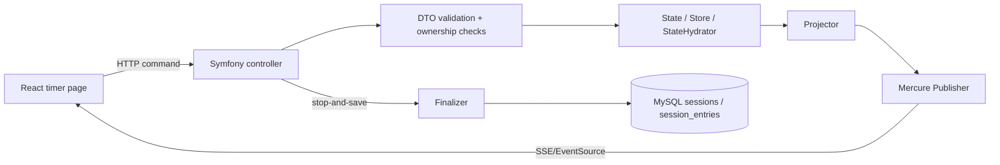

---

{{ Proofread and edited, but please be aware that 
this file was generated with AI and may contain mistakes. }}

---
# LiveTimerSession

Realtime Pomodoro-style timer reference feature built with Symfony, Symfony Cache, and Mercure.

This module exists as a backend-owned realtime feature (example, for now) for the codebase. 
It shows how to implement a multi-client live feature without introducing a separate websocket backend.

---
## Why this exists

The original timer page is a local UI-first timer.

`LiveTimerSession` is the reference implementation for a backend-owned realtime timer:
- the browser sends explicit commands
- Symfony applies the state transition
- ephemeral live state is stored in cache
- Mercure broadcasts the resulting projection
- only finalized session results are written to MySQL

---

## Core architecture

The feature is split into four responsibilities:

1. **HTTP command/query boundary**
    - controllers receive requests
    - DTOs validate payloads
    - owner checks are enforced at the boundary

2. **Ephemeral live session state**
    - the active timer lives in Symfony Cache
    - this state is temporary runtime state, not durable domain history

3. **Projection + realtime fanout**
    - the backend produces a full projection for the current session
    - Mercure publishes that projection to subscribed clients

4. **Persistence on finalization**
    - when the session is stopped and saved, the live state is converted into durable `Session` / `SessionEntry` data and persisted to MySQL

---

## Request flow

### Read/query flow

- client requests the current live session
- backend loads the live state from cache
- backend projects the state into the transport shape returned to the browser
- browser renders from that projection

### Command flow

- client sends an explicit command such as start, pause, resume, skip phase, reset phase, change config, or stop and save
- backend loads the current live state
- backend applies the transition
- backend persists the updated live state back into cache
- backend projects the updated state
- backend publishes the projection through Mercure
- subscribed clients receive the full updated projection

### Finalization flow

- client sends `stop-and-save`
- backend loads the live state
- backend resolves the effective timer state
- backend converts it into durable session data
- backend persists the result to MySQL
- backend publishes a deleted event for the live session
- backend removes the ephemeral live session from cache

---

## State model

The feature intentionally separates state into three layers.

### 1. Durable domain state

Persisted in MySQL:
- `sessions`
- `session_entries`

This is historical data that should remain after the live timer is finished.

### 2. Ephemeral live state

Stored in Symfony Cache while the timer is active.

This state contains the runtime information needed to drive the live timer, such as:
- owner user id
- status
- phase
- configured work/break durations
- either `phaseEndsAt` or `remainingMs`
- accumulated focus and break time
- related subject/task ids
- timestamps such as `startedAt` / `updatedAt`

This state is temporary and should disappear when the live session is deleted or finalized.

### 3. Realtime transport state

Published through Mercure as a projection.

The browser does not receive raw cache internals or mutate cache state directly. 
It receives a projection intended for transport and rendering.

---

## Ownership model

The authenticated user who creates a live session is the only user allowed to:
- load it
- mutate it
- delete it
- stop and save it

So live timer sessions are currently **owner-only**.

==> MUST BE CHANGED, THIS IS THE NEXT PART TO IMPLEMENT

(A future extension could add read-only share 
tokens for observers while keeping commands owner-only.
After this, also implement other permissions to (not) share when desied.) 

---

## Command model

The browser is not allowed to send full timer state back as authority.

Instead, it sends explicit commands.

Supported command categories:

- create session
- start
- pause
- resume
- skip phase
- reset phase
- change config
- stop and save
- delete session

This keeps ownership of business rules in the backend and 
makes invalid state transitions much easier to prevent.

---

## Projection model

Mercure publishes **full projections** on **discrete state transitions**.

The server does **not** send per-second updates.

Instead:
- when the timer changes, the backend publishes a full projection
- when the timer is running, the projection exposes `phaseEndsAt`
- when the timer is not running, the projection exposes `remainingMs`
- the frontend derives the visible countdown locally from the latest projection

This is the key scalability and simplicity decision in the feature:
- backend owns transitions
- frontend owns visual ticking between transitions

==> other timer/sessions options will have to be added/configured since
right now it is solely pomodoro

---

## Why Symfony Cache is used for the live timer

The live timer is runtime state, not durable business history and thus
should not be store in MySQL to avoid mixing temporary execution state
with durable session history.

That would make the domain model noisier and create cleanup concerns 
for data that should naturally expire or be deleted after finalization.

Symfony Cache is a better fit because the live timer:
- is short-lived
- is mutable
- is only relevant while active
- does not need durable history until finalized

---

## On the use of Mercure

Mercure is a provides for this feature:
- backend-owned transitions
- low-latency fanout to one or more viewers
- simple browser subscriptions via `EventSource`
- no custom websocket protocol (→ SSE)
- no permanently open bidirectional application channel

This feature is fundamentally command-driven, not stream-driven.

---

## Structure

Again, up for change when refining, changing and adding to this feauture.

```text
backend/src/LiveTimerSession/
├── Controller
│   ├── AbstractSessionController.php
│   ├── SessionActionController.php
│   └── SessionController.php
├── DTO
│   ├── Command
│   │   ├── ChangeConfig.php
│   │   ├── CreateSession.php
│   │   ├── EmptyCommand.php
│   │   └── StopSession.php
│   └── DurationDto.php
├── Enum
│   ├── SessionPhase.php
│   ├── SessionStatus.php
│   └── SessionType.php
├── README.md
└── Service
    ├── Finalizer.php
    ├── Projector.php
    ├── Publisher.php
    ├── StateHydrator.php
    ├── State.php
    ├── Store.php
    └── TimeService.php
```

## Responsibility of each part

### Controller

#### `SessionController`
Responsible for session-level endpoints such as:
- create
- get
- delete

#### `SessionActionController`
Responsible for command endpoints such as:
- start
- pause
- resume
- skip phase
- reset phase
- change config
- stop and save

#### `AbstractSessionController`
Shared controller helpers:
- authentication / ownership checks
- common JSON response helpers
- common command application flow

### DTO

Command DTOs define the HTTP input contract and validate request payloads.

Examples:
- session creation payload
- empty command payloads
- config changes
- stop/finalization options
- duration value objects

This keeps input validation at the boundary instead of inside transport arrays or controller conditionals.

### Enum

Enums give the timer vocabulary a stable domain language:
- `SessionPhase`
- `SessionStatus`
- `SessionType`

This reduces stringly-typed branching and makes the state model easier to defend in review.

{{ SessionStatus and SessionType originate from when the original Session-entity was created,
SessionPhase is only for the livetimer, these must all be updated later}}

### Service

#### `State`
Represents the live timer session state in the backend.

This is the central model for the active timer and should be the place where timer invariants are expressed.

#### `StateHydrator`
Maps between stored/raw data and the in-memory state representation.

This isolates serialization concerns from domain behavior.

#### `Store`
Owns persistence of the live session in Symfony Cache:
- create
- load
- save
- delete

#### `TimeService`
Centralizes time-related operations.

This avoids duplicating clock logic and timestamp conversion rules across projection, transitions, and finalization.

#### `Projector`
Builds the transport projection returned by HTTP and published through Mercure.

It is responsible for shaping the data the frontend consumes.

#### `Publisher`
Publishes full projections and deleted events through Mercure.

#### `Finalizer`
Converts the live session into durable domain data and persists it to MySQL when the session is stopped and saved.

---

## Some design rules

### 1. Backend is the full owner
The browser never owns the timer state.

### 2. Commands are explicit
The browser sends intent, not authoritative snapshots.

### 3. Live state is ephemeral
Cache is used for active timer runtime state only.

### 4. Persistence happens at the end
MySQL only stores the finalized result.

### 5. Mercure publishes full projections
Subscribers receive the latest whole state projection, not partial diffs.

### 6. No per-second backend ticking
The frontend derives the visible countdown from projected timing fields.

---

## Frontend expectations

The frontend should treat the projection as the single live input.

That means:
- keep the latest projection as source state
- derive visible countdown from `phaseEndsAt` or `remainingMs`
- subscribe to Mercure topic updates
- do not implement a second authoritative timer model in the client

This also should keep frontend testing simpler:
- raw backend projection can be inspected directly
- derived frontend display state can be tested as a pure function

---

## Typical lifecycle

1. user creates a live timer session
2. backend stores initial state in cache
3. backend returns and publishes the initial projection
4. user sends commands
5. each command updates cache state and republishes the full projection
6. frontend renders from the latest projection
7. user stops and saves
8. backend finalizes the session into MySQL
9. backend publishes a deleted event
10. backend removes the live session from cache

---

## Some arguments for the final project defense

Each concern has a clear place:

- controllers handle HTTP and security
- DTOs validate input
- enums stabilize domain vocabulary
- state/hydration/store manage the active session model
- time logic is centralized
- projector shapes transport data
- publisher handles realtime fanout
- finalizer persists durable history

Nothing is forced to do two unrelated jobs.

---

## Files of interest

### Backend
- Directory: `backend/src/LiveTimerSession/..`

### Frontend
- Directory: `frontend/src/features/liveTimerSession/..`
- `frontend/src/lib/mercure.js`
- `frontend/src/lib/liveTimerSessionApi.js`
- `frontend/src/pages/TimerMercurePage.jsx`

---

## High-level diagram



---

### Current limitations
- owner-only access
- no share token / public read-only viewing
- no collaborative control model
- no per-phase historical breakdown beyond what is finalized into durable session data
- the timer page is still primarily a reference/debug page, not the final UX

---

### Future extensions

- read-only shared viewer tokens
- richer stop-and-save inputs in the UI
- subject/task selection in the timer page
- stronger automated tests around state transitions and finalization
- better extraction of a reusable pattern for other Mercure-backed live features
